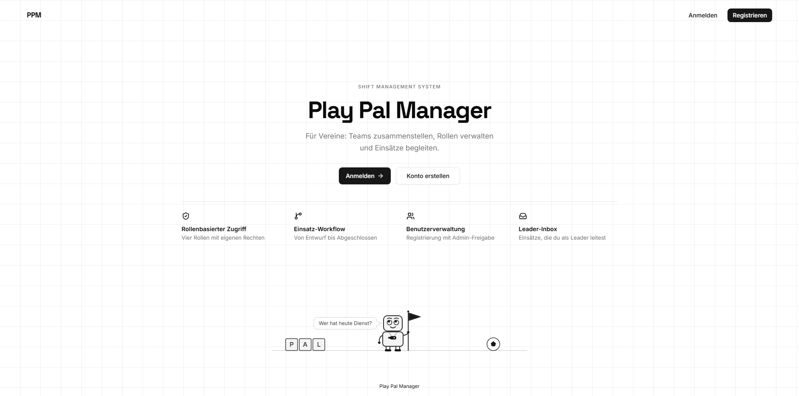

# PPM Frontend

[](https://github.com/djzh23/ppm-frontend/actions/workflows/ci.yml)

Play Pal Manager (PPM) ist die Weboberfläche für die Einsatzplanung von Vereinen und gehört zum Backend https://github.com/djzh23/ppm-backend.

## Demo

Live: https://ppmv2.vercel.app

Das Backend läuft im Gratis-Tarif von Render. Nach Inaktivität braucht es etwa 50 Sekunden zum Aufwachen.

Demo-Zugänge (Passwort: `Pass123$`):

- `lena.hartung@example.com`, Koordinator
- `tim.adler@example.com`, Festmitarbeiter
- `nora.feld@example.com`, Honorarkraft

## Screenshots



## Funktionen

Admin prüft Registrierungen, gibt sie frei oder lehnt sie ab und weist Rollen zu.

Koordinator legt Einsätze an, pflegt Unterkünfte und Teamzuweisungen, genehmigt Vorschläge und kann Einsätze stornieren.

Festmitarbeiter sieht zugewiesene Einsätze, nimmt Einladungen an oder lehnt sie ab.

Honorarkraft sieht zugewiesene Einsätze, nimmt Einladungen an oder lehnt sie ab.

Leader (Festmitarbeiter oder Honorarkraft) schlägt das Team vor, startet den Einsatz und beendet ihn.

Anmeldung per JWT mit automatischer Token-Erneuerung.

Status in der Oberfläche: Entwurf, Zur Genehmigung, Geplant, Aktiv, Abgeschlossen, Storniert.

Ablauf eines Einsatzes: Der Koordinator legt ihn als Entwurf an. Der Leader schlägt das Team vor. Der Koordinator genehmigt. Der Leader startet den Einsatz und beendet ihn.

## Stack

Next.js 16, React 19, TypeScript 5, Tailwind CSS 4, shadcn/ui mit Radix UI.

## Starten

Node.js 22 oder neuer.

```bash
npm install
cp .env.example .env.local
npm run dev
```

In `.env.local` muss `NEXT_PUBLIC_API_BASE_URL` stehen. Der Entwicklungsserver nutzt Port 3000. Fehlt die Variable, bleibt der Start still. Der Fehler erscheint erst beim ersten Request.

Das Backend ppm-backend muss erreichbar sein.

## Qualität

Die CI auf `main` führt Typecheck und Build aus. Es gibt keine automatisierten Tests und keinen Linter.

## Bekannte Grenzen und Roadmap

- Tokens liegen in `localStorage`. Roadmap: httpOnly-Cookies über ein Backend-for-Frontend.
- Die Rollenprüfung im Frontend läuft nur im Client. Roadmap: Prüfung auf dem Server per Middleware.
- Admin hat keine Menüpunkte zu Team und Unterkünften.
- Teilnehmer entfernen fehlt.
- Standorte löschen fehlt.
- Registrierung und die Forbidden-Seite sind auf Englisch.

## Lizenz

MIT, siehe [LICENSE](LICENSE).
