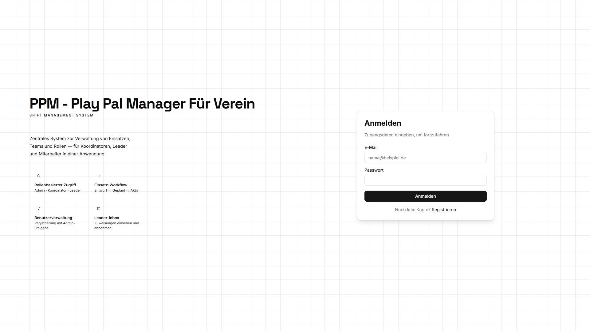
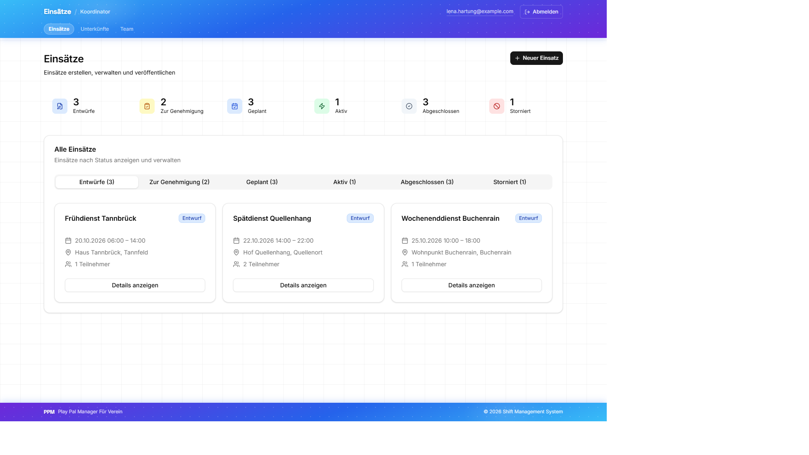
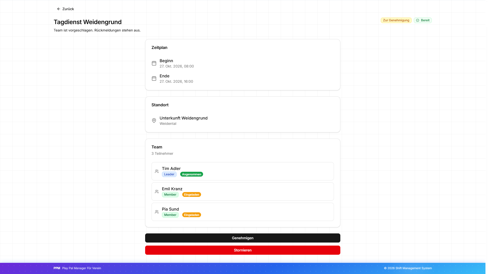
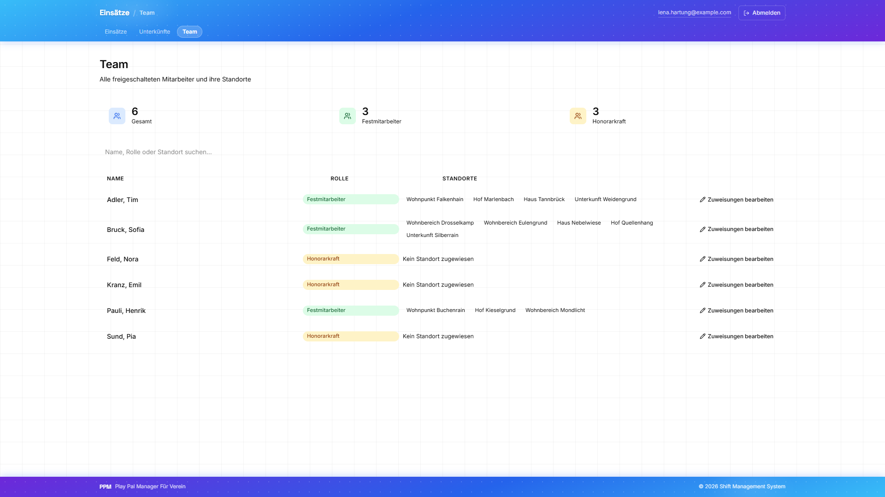
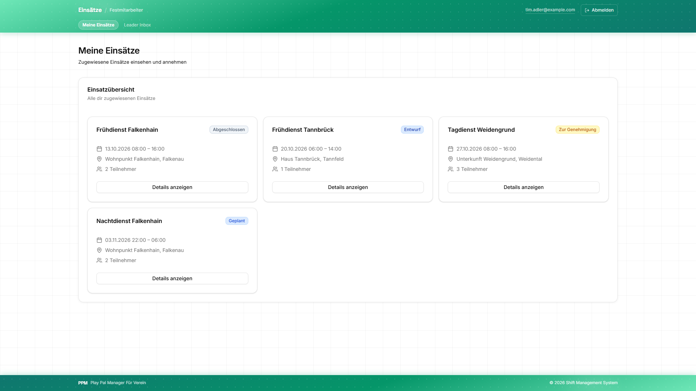
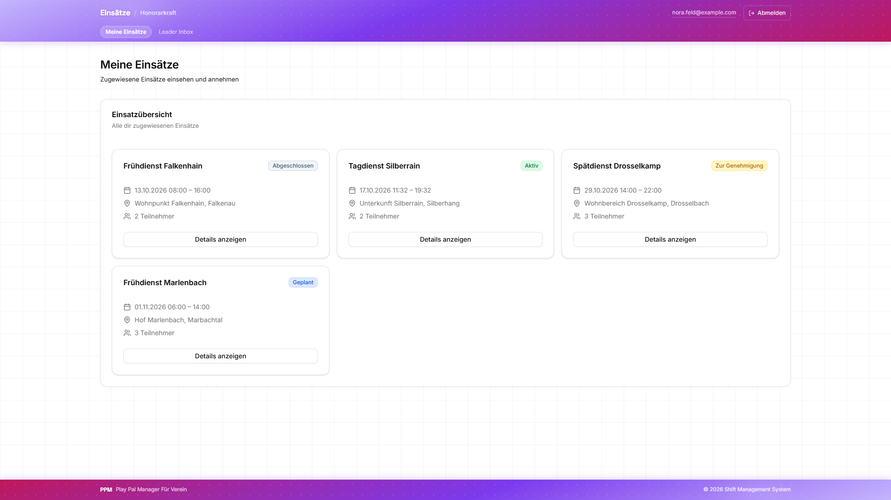

# PPM Next.js Client

[](https://github.com/djzh23/ppmv2-next-frontend/actions/workflows/ci.yml)

This is the web frontend for **PPM V2**, a shift and team management system built on a .NET REST API.

The backend is designed to be client-agnostic. This Next.js app is one possible client, chosen for rapid prototyping and to demonstrate modern frontend development alongside the .NET backend. A future client is planned as a .NET MAUI Blazor Hybrid app.

**Live Demo:** [ppmv2.vercel.app](https://ppmv2.vercel.app)
**API:** [ppmv2-hbb4.onrender.com](https://ppmv2-hbb4.onrender.com)
**Backend repo:** [PpmV2](https://github.com/djzh23/PpmV2) (.NET 10, Clean Architecture)

---

## Shift Workflow

The frontend reflects a multi-role shift planning flow:

1. **Coordinator** creates a shift (title, time, location) and assigns a Festmitarbeiter as Leader. The shift is saved as `Draft`. The Coordinator can also assign themselves as Leader.
2. **Leader** sees the Draft shift in their Leader Inbox, adds team members from available staff, and proposes the team when ready.
3. **Team members** receive the shift invitation (`PendingApproval`) and can accept or decline.
4. Once **all members accept**, the shift auto-transitions to `Planned`.
5. **Leader** starts the shift (`Active`) and completes it when finished. The **Coordinator** sees the status and team, and can cancel the shift.

---

## Features

- **Role-based access control** with four user roles: Admin, Coordinator, Festmitarbeiter, Honorarkraft
- **Shift workflow** from Draft to Planned, Active, Completed, or Cancelled
- **User management** with admin approval and role assignment
- **Coordinator dashboard** to create shifts and assign a Leader
- **Leader inbox** to manage Draft shifts, add team members, and propose
- **Staff inbox** for invited members to accept or decline assignments

---

## Screenshots

Live demo, October 2026.













---

## Tech Stack

| Layer | Technology |
|---|---|
| Framework | Next.js 16 (App Router) |
| Language | TypeScript 5 |
| UI | React 19, shadcn/ui, Radix UI |
| Styling | Tailwind CSS 4 |
| Auth | JWT (Bearer token) |
| Deployment | Vercel |

---

## Local Development

**Prerequisites:** Node.js 20+, running PPM V2 backend (default: `http://localhost:5105`)

```bash
# 1. Install dependencies
npm install

# 2. Create environment file
cp .env.example .env.local

# 3. Start dev server
npm run dev
```

`.env.local` requires one variable:

```env
NEXT_PUBLIC_API_BASE_URL=http://localhost:5105
```

Without `NEXT_PUBLIC_API_BASE_URL`, the app fails to start with an error message.

Demo accounts (password: `Pass123$`):

The Admin account is not publicly available.

| Email | Role |
|---|---|
| `lena.hartung@example.com` | Coordinator |
| `tim.adler@example.com` | Festmitarbeiter |
| `nora.feld@example.com` | Honorarkraft |

---

## Roadmap

- Notifications: in-app alerts for shift assignments, proposals, and responses
- Decline with reason: optional message when a member declines a shift
- Remove participant: Leader can remove members from a Draft shift
- Replace JWT localStorage auth with BFF pattern and HttpOnly cookies
- .NET MAUI Blazor Hybrid client as the primary production frontend
